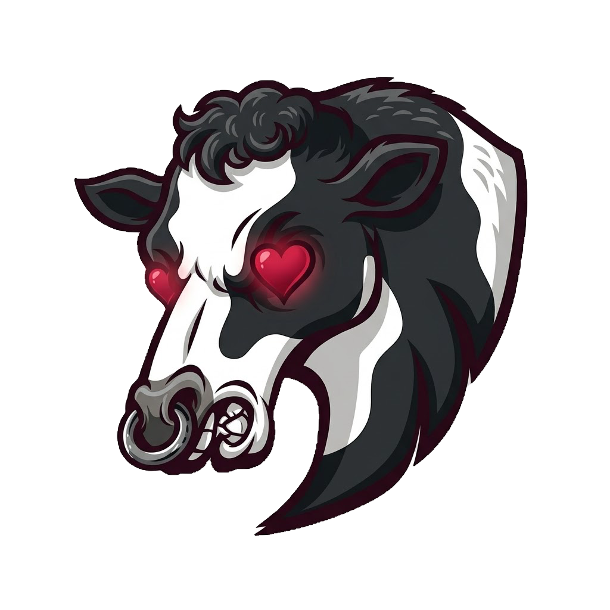

> This is a vibe-coded app for my personal productivity, it is not intended for other people or to represent great engineering work. Use at your own risk!

<div align="center">



# CowTerm

**A GPU-accelerated terminal emulator and session manager.**

</div>

Every visible pixel — glyphs, backgrounds, cursor, selection — is composited
on the GPU from a CoreText glyph atlas. Sessions, the fuzzy palette, MRU
ordering and ring-back notifications replace the tmux-sessionizer workflow.

## Build

CowTerm is a standalone [eacp](https://github.com/eyalamirmusic/eacp) app. It
pulls eacp, [emberstore](https://github.com/tamber-inc/emberstore) and the rest
of its dependencies with [lockstep](https://github.com/jamierpond/lockstep),
which pins each one in `lockstep.lock` to a commit and a hash of its files, so
every machine builds the same sources. No monorepo checkout required:

```bash
cmake -S . -B build -G Ninja
cmake --build build --target CowTermApp
open build/Terminal/CowTerm.app
```

The `CowTermDaemon` binary is built and copied into the app bundle
automatically. To build against a local eacp checkout instead of fetching it,
pass `-DLOCKSTEP_eacp_SOURCE=/path/to/eacp`.

Branch-pinned dependencies (Rudder and emberstore at `main`) stay at their
locked commit until `just update-deps`, which moves every package to where its
branch or tag points now and rewrites `lockstep.lock`; commit the result.

### Where the code lives

- `Lib/Emulator` (`CowTerm::Emulator`): bytes in, screen state out. Parser, screen, scrollback, reflow.
- `Lib/Shell` (`CowTerm::Shell`): the process behind a pane, the PTY and the `Shell` interface.
- `Lib/TerminalView` (`CowTerm::TerminalView`): draws an emulator and handles keys, mouse, scrolling and copy mode. Links Emulator and Shell.
- `Lib/Multiplexer` (`CowTerm::Multiplexer`): panes that outlive the app. The daemon protocol and client, remote hosts over ssh, `ct bridge`, config. Links Emulator and Shell, never TerminalView, so the headless build has no graphics.
- `Terminal/` is the app's own UI, `Daemon/` is `CowTermDaemon`, `Remote/` is the headless `ct`.

### macOS privacy permissions

CowTerm is not certificate-signed. macOS remembers Accessibility
and other privacy grants against the responsible app's signature
(for a terminal that's CowTerm, for every command it runs), and each rebuild is
a new ad-hoc identity, so those grants re-prompt after a rebuild. `just run`
resets Accessibility before launching for that reason, so the prompt is real
rather than a stale switch in System Settings.

Purpose strings in
CowTerm's plist let macOS explain camera, microphone, system-audio, automation
and other requests made by commands you run; they never grant anything without
your consent.

### The permissions panel

CowTerm > Permissions… (also in the tray menu) lists every macOS privacy grant
CowTerm asks for, with live status: Accessibility, Full Disk Access,
Automation, Desktop/Documents/Downloads and Notifications.
Commands in a CowTerm shell are charged to CowTerm, so these are what they get.
Grant shows macOS's prompt where there is one, else opens the exact System
Settings pane; for lists that take an app, drag CowTerm's icon from the panel
into them. It checks once a second only while open. After a reset its Relaunch
button quits normally (the daemon keeps every shell) and reopens CowTerm.

Reset all permissions… (or `CowTerm --reset-permissions [service]` from any
shell) runs `tccutil reset All` for CowTerm's bundle id. Notifications aren't
TCC, so a reset leaves them alone.

### `ct`

`ct` is the CowTerm executable's CLI mode (`ct notify-user`, `ct version`).
`ct --version` prints the version and the commit it was built from, e.g.
`ct 0.1.0+f30059f` (`.dirty` on the end for uncommitted changes).
`just install` symlinks it to `~/.local/bin/ct`. Screen capture lives in the
separate `screencap` tool.

## Keys

| Key | Action |
| --- | --- |
| `Ctrl+A f` / `p` (or `Cmd+K` / `Cmd+T`) | Open the palette |
| `Ctrl+W` (in the palette) | Delete the word behind the caret |
| `Ctrl+A i` | Lazygit popup in the active pane's directory |
| `Ctrl+A "` | Split pane below (in the pane's directory) |
| `Ctrl+A %` | Split pane right (in the pane's directory) |
| `Ctrl+A h/j/k/l` | Focus pane in direction |
| `Ctrl+A x` | Close the active pane (last pane ends the session) |
| `Ctrl+A z` | Zoom / unzoom the active pane |
| `Ctrl+A o` | Cycle pane focus |
| `Cmd+N` | New session in the active pane's directory |
| `Ctrl+A 1..9` (or `Cmd+1..9`) | Switch to session by index |
| `Ctrl+A Ctrl+A` | Send a literal `Ctrl+A` to the shell |
| `Cmd+C` / `Cmd+V` | Copy selection / paste (bracketed) |
| `Cmd++` / `Cmd+-` | Font size |
| `Shift+PageUp/PageDown/Home/End` | Scrollback |

Pane layouts (splits, ratios, per-pane directories) persist and restore with
the session. Splits open in the pane's live working directory, read from the
kernel — no shell integration required.

## The palette

One overlay, everything fuzzy-searchable (Grazer-style scoring + MRU):

- **Open sessions** first, most-recently-used first. Sessions running a
  Claude Code conversation show `✳`, its title, and a `claude` badge — and
  match the query "claude".
- **Projects** below: depth-1 directories under `searchDirs` (hidden ones
  too, so `~/.config` is a hit), Enter spawns a session there (or switches
  if one exists).

Type to rank; `Enter` opens, `Esc` closes, arrows or `Ctrl+P/N` move.

## The lazygit popup

`Ctrl+A i` opens lazygit full-window over the current session, in the active
pane's directory — tmux's `display-popup -E -w 100% -h 100% lazygit`. Quit
lazygit (`q`) and the popup is gone with focus back where it was;
`Ctrl+A i` again force-dismisses. The command runs through your login shell
(`$SHELL -c`), so PATH and `$EDITOR` apply: lazygit's `e` opens nvim inside
the popup's own PTY, edit, `:q`, and you're back in lazygit. The popup's
shell is in-process and ephemeral — it never goes to the session daemon.

## Ring-back notifications

Anything inside a session can post a desktop notification; clicking it
activates the app and jumps straight to that session:

```bash
printf '\033]9;CI green — come back\007'          # OSC 9
printf '\033]777;notify;Build;finished\007'        # OSC 777
```

Notifications from the session you're actively looking at are suppressed.
Wire it to Claude Code with a `Stop` hook that prints the sequence, and the
"Claude finished → notification → click → you're back in that pane" loop is
closed.

## Asking the user (`ct notify-user`)

An agent in a pane can stop and ask. The running app opens a small window that
floats over everything, naming the pane (click the header or **Show pane** to
jump to it), and `ct` blocks until the user answers. When CowTerm is not the
app in front it also posts a notification; clicking that jumps to the pane too.

```
ct notify-user --content "xyz done, requires your input"
ct notify-user --content "foo bar" --options "this one" "that one"
ct notify-user --content "foo bar" --options "ship it" "hold" --allow-type-response
ct notify-user --pane <pane-id> --content "..."
ct notify-user --title "tamber-web · fix-auth" --content "..."
```

With no `--options` and no `--allow-type-response` the window has a single OK.
Several asks at once get a window each, cascaded.

- stdout: the chosen option, or the typed answer, on one line.
- exit 0 answered; 1 dismissed (Esc, Dismiss or the close button), nothing printed;
  2 usage error; 4 CowTerm not running or gone before an answer.
- Killing `ct` (Ctrl-C) closes its window.
- The pane: every pane's shell has `COWTERM_PANE` set to its id, so no flag is
  needed inside CowTerm; `--pane` overrides it.

From Claude Code:

```sh
answer=$(ct notify-user --content "Tests pass. Merge?" --options "merge" "wait")
[ "$answer" = "merge" ] && gh pr merge
```

## Config — `~/.config/cowterm.json`

```json
{
    "searchDirs": ["~/projects", "~/projects/mayk-it", "~"],
    "font": "JetBrains Mono",
    "fontSize": 13,
    "theme": "rosepine"
}
```

Unknown keys are ignored; missing keys keep defaults. Themes: `rosepine`,
`tokyonight`. JetBrains Mono ships embedded in the binary (ResEmbed) and is
registered with CoreText at startup — no font install needed.

## The shell

macOS/Linux panes run your login shell (`$SHELL`). Windows panes come up as
the **Visual Studio Developer PowerShell**: CowTerm launches `pwsh`/`powershell`
and runs `Enter-VsDevShell` at startup (locating the install with `vswhere`),
so the MSVC toolchain — `cl`, `link`, `cmake`, `ninja` — is on `PATH` in every
pane, just like the "Developer PowerShell for VS" profile. When no Visual
Studio install is found it falls back to an ordinary PowerShell prompt; set
`COWTERM_NO_DEVSHELL=1` to opt out even when one is.

## The session daemon (real tmux mode)

Shells don't belong to the GUI: a headless `CowTermDaemon` (bundled next to
the app binary, launched on demand) owns every PTY and the app attaches over
eacp IPC (`IPC::Messenger`, name `cowtermd`). Quit, crash, or update the
app and the shells keep running; the next launch re-adopts each pane by its
persisted `shellId`, replays the daemon's 256K output buffer through the
parser, and nudges the winsize so full-screen apps repaint. Killing the app
with SIGKILL loses nothing.

Tray → "Quit (shells keep running)" (or `Cmd+Q`) detaches; "Kill everything
& quit" tears the server down. If the daemon can't be reached the app falls
back to in-process shells transparently. The daemon retires itself after a
minute with no shells and no client.

## Background mode

Closing the window does not quit: the app keeps running with every shell
alive (the window just hides), tmux-server style. Get back via the menu-bar
tray icon's Show CowTerm, by clicking the Dock icon, or by clicking any
ring-back notification. Only an explicit Quit (`Cmd+Q`, tray →
Quit, or closing the last shell) tears sessions down.

## State

Open sessions and MRU stamps persist via
[emberstore](https://github.com/tamber-inc/emberstore) under
`~/Library/Application Support/tamber/cowterm/`. Relaunching restores
the workspace: sessions and pane layouts restore, and panes whose shells
still live in the daemon reconnect to them.

## Not yet

Scrollback search, a
single-instance guard (two GUIs racing the same saved state can duplicate
session names), and finishing the Windows backends are next.
